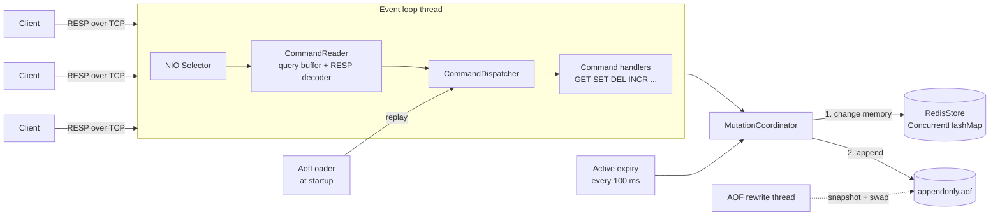
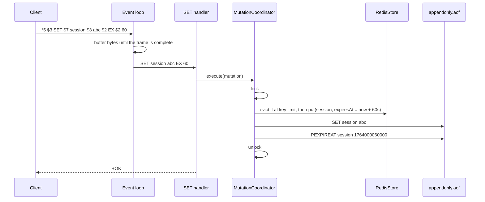
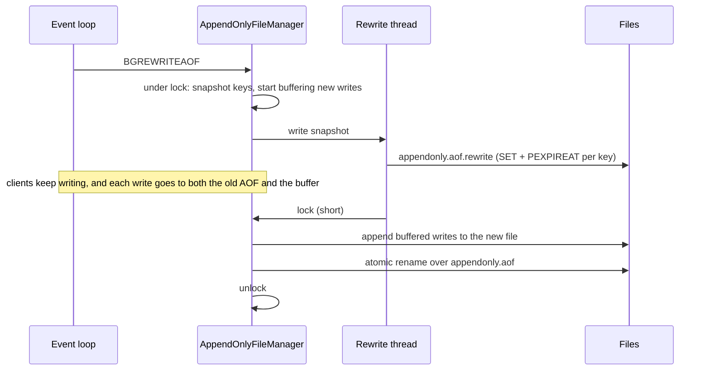
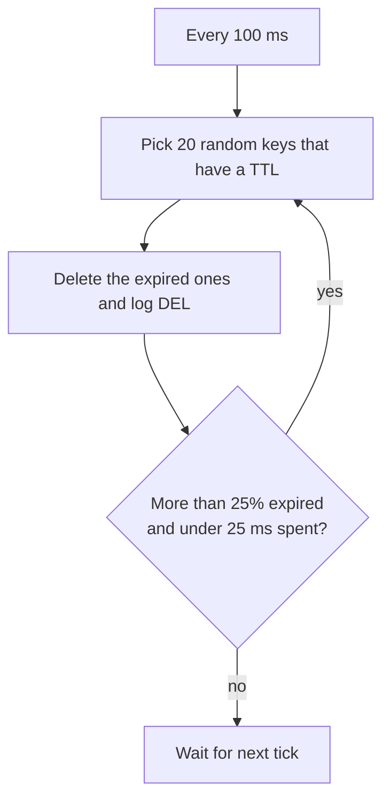

# redis-clone

[](https://github.com/virtual424/redis-clone/actions/workflows/build.yml)

A Redis-compatible in-memory key-value server written in Java 21. It speaks the Redis wire protocol (RESP), so `redis-cli` and client libraries such as redis-py can talk to it.

It covers the parts of Redis that matter in backend interviews and production: a single-threaded event loop, protocol framing, expiry, eviction, persistence and transactions.

## Features

| Area | What it does |
| --- | --- |
| Networking | Non-blocking TCP server on one event-loop thread (Java NIO `Selector`, the equivalent of `epoll`) |
| Protocol | RESP2 parser with a per-client query buffer: commands split across TCP reads, pipelining and multi-megabyte values all work |
| Commands | `PING` `ECHO` `SET` (with `EX`) `GET` `DEL` `INCR` `EXPIRE` `PEXPIREAT` `TTL` `MULTI` `EXEC` `DISCARD` `INFO` `BGREWRITEAOF` `SLEEP` `CLIENT` `LATENCY` |
| Expiry | Lazy (on read) plus active: samples 20 keys with a TTL 10 times a second and repeats while more than 25% are expired |
| Eviction | When the key limit is reached: `simple-first`, `allkeys-random` or approximate `allkeys-lru` (24-bit LRU clock, sampled like Redis) |
| Persistence | Append-only file, replayed at startup; background rewrite (`BGREWRITEAOF`) that does not block clients |
| Transactions | `MULTI` / `EXEC` / `DISCARD`, with `EXEC` atomic with respect to background expiry |
| Encodings | Values tagged `int`, `embstr` (≤ 44 bytes) or `raw`, like Redis's string encodings |
| Operations | Graceful shutdown (finishes the current batch, closes clients, stops background threads), `max-clients` limit |

## Architecture



- **One thread runs all commands.** Like Redis, there are no locks between clients: commands run one after another on the event-loop thread, so each command is atomic.
- **Every write goes through `MutationCoordinator`.** It holds one lock while it changes memory and appends to the AOF, so the file always matches memory. Background expiry and the AOF rewrite take the same lock.
- **Handlers describe what changed.** A handler returns the commands that reproduce its change (for example `SET k v` plus `PEXPIREAT k <time>`), and the persistence layer writes them. Handlers never touch the file.

### What happens on `SET session abc EX 60`



The expiry is logged as an absolute time. Logging `EX 60` would give the key a fresh 60 seconds every time the file is replayed.

### Background AOF rewrite

The AOF grows with every write: 100 `INCR`s are 100 lines for a single key. `BGREWRITEAOF` replaces the file with the shortest set of commands that rebuilds the current data, without stopping clients:



### Active expiry

Keys that expire but are never read again would stay in memory forever with lazy expiry alone. Checking every key is O(n), so Redis samples instead, and so does this server:



Keys with a TTL are kept in a separate index (an array plus a key-to-position map), so picking a random key is O(1) instead of a scan.

## Getting started

You need Java 21. Maven comes with the project (`mvnw`).

```bash
git clone https://github.com/virtual424/redis-clone.git
cd redis-clone

# Linux / macOS
./mvnw spring-boot:run

# Windows
mvnw.cmd spring-boot:run
```

The server listens on **port 6369** (not 6379, so it does not clash with a real Redis on the same machine).

Connect with `redis-cli`:

```bash
redis-cli -p 6369
127.0.0.1:6369> SET greeting hello EX 60
OK
127.0.0.1:6369> GET greeting
"hello"
127.0.0.1:6369> TTL greeting
(integer) 57
```

No `redis-cli` on Windows? Use WSL, or run it from Docker: `docker run -it --rm redis redis-cli -h host.docker.internal -p 6369`.

### Run with Docker

```bash
docker build -t redis-clone .
docker run -p 6369:6369 -v redis-clone-data:/data redis-clone
```

The AOF is stored on the `/data` volume, so data survives container restarts.

### Try persistence

```bash
redis-cli -p 6369 SET user:1 hardik
# stop the server (Ctrl+C) and start it again
redis-cli -p 6369 GET user:1     # "hardik"
```

## Configuration

Set in `src/main/resources/application.properties`, or as environment variables (`REDIS_PORT`, `REDIS_KEYSLIMIT`, ...).

| Property | Default in the file | Meaning |
| --- | --- | --- |
| `redis.host` | `0.0.0.0` | Address to bind |
| `redis.port` | `6369` | TCP port |
| `redis.max-clients` | `2000` | Connections beyond this get `-ERR max number of clients reached` |
| `redis.keys-limit` | `5` | Eviction starts when a new key would exceed this. Set low on purpose so you can watch eviction; raise it for real use |
| `redis.eviction-strategy` | `allkeys-lru` | `simple-first`, `allkeys-random` or `allkeys-lru` |
| `redis.eviction-ratio` | `0.2` | Share of `keys-limit` to evict in one go |
| `redis.aof-file` | `appendonly.aof` | Path of the append-only file |
| `redis.active-expire-interval-ms` | `100` | How often active expiry runs |

## Tests

```bash
./mvnw verify
```

The tests start real servers on free ports and talk to them over TCP. They cover:

- **Protocol:** a command split at every possible byte, 10,000 pipelined commands, 1 MB values, malformed input
- **Persistence:** data and TTLs survive a restart, keys that expired while the server was down are gone, a crash in the middle of a write, `BGREWRITEAOF` compaction
- **Expiry:** keys nobody reads are still deleted, the 25% rule stops early, the TTL index stays in sync
- **Server:** `MULTI`/`EXEC`, eviction at the key limit, the `max-clients` limit

### Benchmark on your machine

With a real Redis installation you can point `redis-benchmark` at the server:

```bash
redis-benchmark -p 6369 -t set,get -n 100000 -q
redis-benchmark -p 6369 -t set,get -n 100000 -P 16 -q   # pipelining
```

Raise `redis.keys-limit` first, or every `SET` triggers eviction.

## Known limitations

These are deliberate trade-offs for a learning project:

- **Strings only.** No lists, hashes, sets or sorted sets yet.
- **RESP2 only.** `HELLO` / RESP3 is not supported. Clients that default to RESP3 (recent redis-py) need `protocol=2`.
- **No fsync policy.** Each write is appended and flushed to the OS, but not `fsync`ed, so a power loss can drop the last writes. Redis's `appendfsync everysec` is the next step.
- **Eviction counts keys, not memory.** Redis evicts by `maxmemory`.
- **Writes to slow clients block the loop.** Replies are written in a loop instead of buffering and waiting for `OP_WRITE`.
- **`SLEEP` blocks every client.** That is intentional: it demonstrates the single-threaded model.

## Project structure

```
src/main/java/com/example/hbhagat/redis_clone/
├── Server/        event loop, client connections, lifecycle and graceful shutdown
├── Protocol/      RESP types, decoder and per-client command reader
├── Command/       dispatcher and one handler class per command
├── Storage/
│   ├── Core/          RedisStore, RedisObject, encodings
│   ├── Expiration/    active expiry and the TTL index
│   ├── Eviction/      eviction policies and the LRU clock
│   ├── Mutation/      MutationCoordinator: memory change + AOF as one step
│   ├── Persistence/   AOF append, rewrite and startup loading
│   └── Statistics/    INFO keyspace numbers
└── Config/        RedisProperties
```
